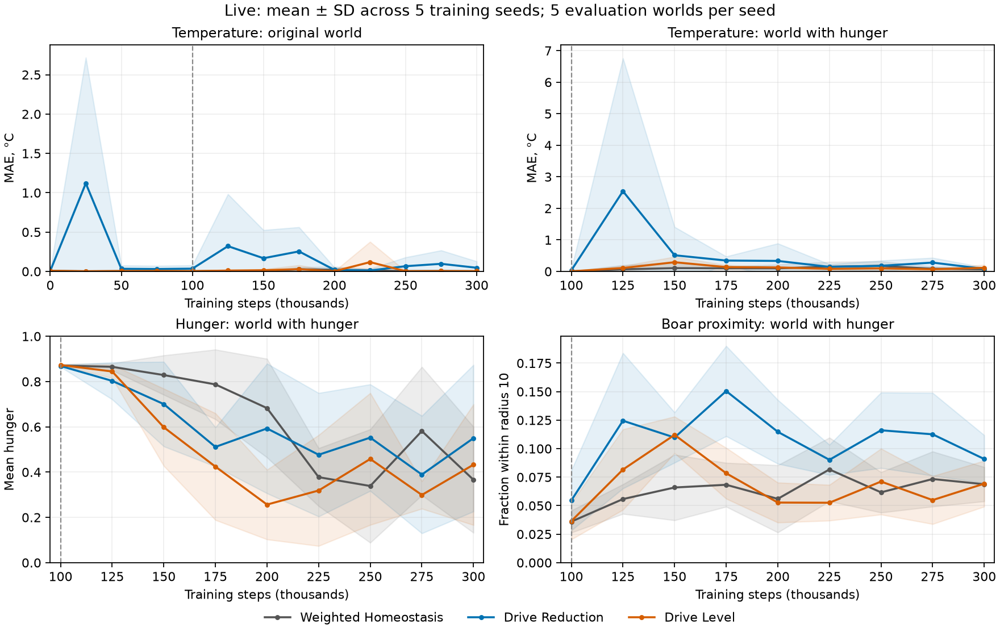

# Live: сравнение физиологической мотивации — 24 октября 2026

**Технически эксперимент выполнен; поведенческие результаты неоднородны.**
Все варианты в среднем снизили голод относительно frozen и random, но различия
между обучающими seed велики. Новые мотивации не дали убедительных данных для
объявления общего победителя. Снижение голода сопровождалось ухудшением температуры
в условиях с едой и частичной потерей избегания кабана в прежнем мире.

## Протокол и техническая корректность

- Две независимые pilot-серии: 6 trials; все 3 повторные пары совпали по action
  hash, счётчикам и метрикам с допуском 1e-9. Все 24 pilot-политики загрузились.
- Основная серия: **15/15 завершённых trials**, 4 500 000 обучающих переходов.
  В каждом 100 000 + 200 000 шагов одной жизни, 74 502 обновления Double DQN,
  14 контрольных точек и 145 оценочных эпизодов; единственная активация на 100 000.
- Все **155 тестов прошли** на закреплённом .NET 10.0.13. Проверены аналитические
  награды, нормализация, независимость от весов, физика/метрики при одинаковых
  действиях, активация, временные метрики и изоляция оценки. Все **60/60**
  экспортированных основных политик загрузились и выполнили шаг без обучения.
- Один общий протокол и идентичные эффективные настройки learner/физики.
  Не менялись исходники мира, потребностей, существующего Homeostasis и сети.
  Новые добавления: один пакетный проект мотиваций и один оценщик `stability-v1`.
- Training/world seeds: 42, 73, 101, 211, 509; оценка на новых seed
  61001, 62003, 63013, 64019, 65029 по 4 000 шагов, каждые 25 000 шагов.
  Общий DQN из continual acceptance: γ=0.97, prioritized replay α=0.6,
  β=0.4; полные параметры в конфигурации. Мир и обе фазы взяты из прежнего pilot.

Конфигурации сохранены до pilot; после основной оценки не менялись.
Варианты исполнялись параллельно через штатный `--variant`. Первый
последовательный старт остановлен на 75k до завершения trial ради
распараллеливания и сохранён отдельно, вне статистики. Seed и лучшие checkpoints
не отбирались. Суммарно по процессам: 2 930.33 с обучения, 1 414.04 с оценки.

Техническое `completed` не означает освоение поведения. У всех trials
`BehaviorOutcome: not-assessed`: новых бинарных критериев успеха не вводилось.

## Итоговое поведение в мире с голодом

Здесь и далее **mean ± выборочное SD по пяти обучающим seed**. Сначала пять
оценочных миров усредняются внутри seed; N=5, а не 25. Меньше — лучше для трёх
основных метрик. Близость кабана — доля времени на расстоянии <10, **прокси**,
а не ущерб или выживание.

| Мотивация | Температура MAE, °C | Голод, 0–1 | Близость кабана, % |
|---|---|---|---|
| Weighted Homeostasis | 0.0686 ± 0.0398 | 0.3662 ± 0.2341 | 6.88 ± 1.50 |
| Drive Reduction | 0.0804 ± 0.0479 | 0.5500 ± 0.3237 | 9.09 ± 2.09 |
| Drive Level | 0.1137 ± 0.0975 | 0.4329 ± 0.2666 | 6.93 ± 2.01 |

Random baseline: MAE **1.4599 °C**, голод **0.8245**, близость **14.50%**.
Необученная политика: **0.0097 ± 0.0058 °C**, **0.8751 ± 0.0000**,
**6.62 ± 1.56%**. Низкая ошибка температуры при голодании не доказывает баланс навыков;
финальное избегание кабана не показывает убедительного улучшения относительно
необученной политики.

| Мотивация | Голод frozen | Изменение после адаптации | Снижение vs frozen / random |
|---|---|---|---|
| Weighted Homeostasis | 0.8709 ± 0.0061 | -0.5047 ± 0.2329 | 58.0% / 55.6% |
| Drive Reduction | 0.8687 ± 0.0038 | -0.3187 ± 0.3238 | 36.7% / 33.3% |
| Drive Level | 0.8734 ± 0.0008 | -0.4405 ± 0.2666 | 50.4% / 47.5% |

Средние трёх основных метрик ниже у Weighted Homeostasis, но порядок по голоду меняется между
seed (таблица ниже). Парные разности — **первый вариант минус второй**, N=5;
минус означает меньшее значение. Значимость и общее превосходство не заявляются.

| Разность | MAE, °C | Голод | Близость, п.п. |
|---|---|---|---|
| Drive Reduction − Weighted Homeostasis | +0.0118 ± 0.0855 | +0.1838 ± 0.4533 | +2.21 ± 2.60 |
| Drive Level − Weighted Homeostasis | +0.0451 ± 0.1277 | +0.0667 ± 0.3488 | +0.05 ± 3.44 |
| Drive Level − Drive Reduction | +0.0333 ± 0.0728 | -0.1171 ± 0.2936 | -2.16 ± 3.20 |

## Стабильность и сохранение прежнего поведения

Временное SD измеряет изменчивость **внутри эпизода**; SD после ± — разброс
между training seed. Малая изменчивость не гарантирует хорошее состояние.
Развороты >90° — описательный прокси.

| Мотивация | Временное SD температуры, °C | Временное SD голода | Развороты >90°, % |
|---|---|---|---|
| Weighted Homeostasis | 0.3669 ± 0.1759 | 0.1971 ± 0.0537 | 56.83 ± 14.62 |
| Drive Reduction | 0.2211 ± 0.0907 | 0.2305 ± 0.0767 | 65.71 ± 12.33 |
| Drive Level | 0.3299 ± 0.2022 | 0.2419 ± 0.0917 | 53.94 ± 8.46 |

Средняя максимальная непрерывная серия по оценочным эпизодам, в шагах:

| Мотивация | Температура вне ±1 °C | Голод >0.8 | Близость кабана <10 |
|---|---|---|---|
| Weighted Homeostasis | 28.4 ± 10.1 | 528.7 ± 687.5 | 41.7 ± 7.2 |
| Drive Reduction | 29.7 ± 19.1 | 974.4 ± 891.7 | 39.3 ± 12.5 |
| Drive Level | 57.4 ± 50.0 | 970.2 ± 1140.3 | 34.0 ± 7.2 |

Единого порядка нет: у Drive Reduction ниже временное SD температуры, но
больше разворотов; у Drive Level короче серии близости кабана. Серии ограничены
горизонтом 4 000 шагов.

Повторная оценка **прежнего мира без голода**: температура на конце первой
фазы → финал; изменения — финал минус конец первой фазы, положительное хуже.

| Мотивация | MAE 100k → 300k, °C | Δ MAE, °C | Δ близости кабана, п.п. |
|---|---|---|---|
| Weighted Homeostasis | 0.0028 → 0.0023 | -0.0005 ± 0.0016 | +1.86 ± 2.15 |
| Drive Reduction | 0.0352 → 0.0465 | +0.0112 ± 0.0938 | +5.06 ± 9.70 |
| Drive Level | 0.0038 → 0.0036 | -0.0002 ± 0.0035 | +1.95 ± 3.33 |

Температура в прежнем мире в среднем сохраняется у Weighted Homeostasis и
Drive Level. У Drive Reduction на seed 509: **+0.1617 °C**, **+21.50 п.п.**
близости кабана. Средняя близость выросла у всех вариантов: данные не подтверждают
полное сохранение избегания. Температурная ошибка в мире с голодом выше frozen у всех.

Кривые выявляют нестабильность, которую скрывает финальная средняя: у
Drive Reduction на 125k температура в новом мире имеет **2.5428 ± 4.2136 °C**
MAE; на seed 101 — **9.8944 °C**, при финале этого seed 0.1298 °C.
Голод меняется немонотонно у всех вариантов. Промежуточные лучшие checkpoints
не подставлялись вместо финальных.

Линии — средние по training seed, заливка — ±SD между ними; отрицательная часть
полосы скрыта физической границей ноль. Пунктир — подключение Hunger/Food.

## Данные по seed и интерпретация

Финальное поведение в мире с голодом; каждая строка усредняет пять оценочных миров.

| Мотивация | Seed | MAE, °C | Голод | Близость, % |
|---|---|---|---|---|
| Weighted Homeostasis | 42 | 0.0436 | 0.1687 | 8.10 |
| Weighted Homeostasis | 73 | 0.1266 | 0.2308 | 7.29 |
| Weighted Homeostasis | 101 | 0.0415 | 0.6637 | 8.21 |
| Weighted Homeostasis | 211 | 0.0374 | 0.1931 | 4.61 |
| Weighted Homeostasis | 509 | 0.0938 | 0.5745 | 6.19 |
| Drive Reduction | 42 | 0.0953 | 0.7430 | 11.04 |
| Drive Reduction | 73 | 0.0354 | 0.7964 | 10.38 |
| Drive Reduction | 101 | 0.1298 | 0.1341 | 7.34 |
| Drive Reduction | 211 | 0.1171 | 0.2663 | 10.33 |
| Drive Reduction | 509 | 0.0244 | 0.8103 | 6.36 |
| Drive Level | 42 | 0.2304 | 0.1412 | 5.73 |
| Drive Level | 73 | 0.0417 | 0.6966 | 5.46 |
| Drive Level | 101 | 0.2071 | 0.1954 | 5.22 |
| Drive Level | 211 | 0.0670 | 0.4278 | 9.33 |
| Drive Level | 509 | 0.0225 | 0.7035 | 8.91 |

Общее расстояние новых мотиваций:
`D = sqrt(sum(((Current-Target)/Scale)^2))`, без весов, clipping и деления
на число потребностей. Reduction: `D(before)-D(after)`; Level: `-0.03*D(after)`.
Weighted Homeostasis: прежняя формула с improvementWeight=0.2,
maximumDriveWeight=10 и прежними весами, включая вес голода 4.

Для непрерывной задачи при ограниченном D и γ=0.97:
`G_reduction = D(initial) + G_level`; на конечном отрезке добавляется
`-gamma^T*D(final)`. Оптимальная политика может совпадать; здесь измеряются
особенности обучения конечным DQN. Основание —
[Keramati & Gutkin, 2014](https://elifesciences.org/articles/04811), не полная
репликация биологических экспериментов статьи.

**Общего победителя не объявляем.** Пять seed в одной среде показывают
неоднородное освоение голода, нестабильность и ухудшение прежнего избегания.
Общее превосходство мотивационного принципа этими данными не установлено.

## Артефакты

[Протокол и команды](drive-motivation-protocol.md),
[pilot](../configs/drive-motivation-pilot.json),
[основная конфигурация](../configs/drive-motivation.json),
[сводный JSON со всеми seed, кривыми, парами и аудитом](drive-motivation-results.json).

Полные локальные данные: `artifacts/experiments/drive-pilot-a`, `drive-pilot-b`,
`drive-pilot-comparison`, `drive-main/{weighted-homeostasis,drive-reduction,drive-level}`,
`drive-comparison`. Сохранены provenance, пакеты, source.patch/untracked-source,
job/results/events/logs и политики. XML: `artifacts/tests/drive-motivation-pinned.xml`.
Скрипты сводки — в `artifacts/experiments/drive-analysis`. Старые результаты
в новую выборку не добавлялись.
