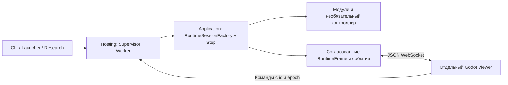

# Единый Runtime и независимый Viewer: результат

Работа выполнена в `master`. Общий путь производства сессий —
`RuntimeSessionFactory`; физика, действия и обучающие переходы проходят через
`RuntimeSession.Step`. World Only не создаёт контроллер. Inference/Evaluation
запрещают обучение даже при вызове Step с параметрами по умолчанию. Эпизодный
runner передаёт terminal до замены мира; Live сохраняет непрерывную жизнь.
Алгоритмы обучения и физические формулы не улучшались.



Core содержит нейтральные физические контракты; Application — исполнение,
режимы, checkpoint-адаптеры и исследовательскую оркестрацию; Hosting — процессы,
команды и Kestrel; Packages — каталог, импорт, проверку и загрузку сборок;
Observation.Contracts — DTO и независимый клиент. В построенном дереве
зависимостей Godot нет Application, Brain, TorchSharp или LibTorch.

Производственные SimulationSession, TrainingEngine, VisualizationSession и
TrainingVisualizationSession удалены. Численный эталон старой оркестрации
сохранён только в tests/LegacyReference; чтение policy v1 использует адаптер,
а не старый цикл. Все исполняемые диагностики и исследования создают общий
Runtime. Исследовательские сессии имеют trialId и явную связь с родителем;
параллельные trials сохраняют отдельные процессы и существующий resume серии.

Supervisor/Worker сохраняют watchdog, изолированную validation, probation,
checkpoint и rollback. Рендер не участвует в физической активации. Сетевые
задачи сериализуют копии отдельно от владельца мира; снимки публикуются до
20 раз/с только при спросе. Без клиентов подготовлено ноль сетевых кадров.
На соединение предусмотрены один отправитель, заменяемый последний снимок и
очередь из 64 событий; очередь команд ограничена 128, кэш результатов — 1024.
Переполнение/таймаут отправки требует полной синхронизации при реконнекте.
Reset/restore/rollback меняют epoch; старые команды отвергаются, включая
повтор запроса с ранее принятым id. На Windows атомарная публикация повторяет
кратковременный конфликт доступа с читающим процессом с ограниченным ожиданием.

Viewer выбирает сессию, переподключается после рестарта Worker, показывает
метрики/возможности и компоненты выбранной сущности. Camera2D поддерживает
масштаб и перемещение. Интерполяция относится только к представлению.
Декларативные сцены/спрайты, привязки, анимации и PCK дополняют программируемые
презентации; температурное поле остаётся программируемым. Ресурсные дефекты
дают fallback. Скриншот получает независимый Viewer через тот же протокол,
а JSON рядом указывает фактически показанный возраст, revision, session/epoch.

## Запуск

```powershell
./tools/build.ps1
./tools/world.ps1 run --mode world-only --config configs/world-only.json --directory artifacts/worlds/a
./tools/world.ps1 run --mode learning --config configs/runtime.json --directory artifacts/worlds/b
./tools/world.ps1 run --mode inference --policy POLICY --directory artifacts/worlds/c
./tools/world.ps1 list
./tools/viewer.ps1 -Session SESSION_ID
./tools/world.ps1 pause --session SESSION_ID
./tools/world.ps1 speed --session SESSION_ID --value 100x
./tools/world.ps1 resume --session SESSION_ID
./tools/world.ps1 checkpoint --session SESSION_ID
./tools/world.ps1 stop --session SESSION_ID
```

Пакеты готовятся явно и публикуются новой версией в отдельном каталоге.
live/train/evaluate остаются оболочками общих политик. Launcher открывает мир,
Viewer или оба процесса; закрытие окна не останавливает Host. Полные инструкции:
[протокол и ресурсы](observation-runtime.md), [Launcher](launcher.ru.md),
[модули](runtime-modules.md), [защищённый Host](autonomous-world.md).

## Проверки

Сборки решения Release и Godot Debug завершились без ошибок и предупреждений.
Полный тестовый прогон включает прежние модульные/checkpoint/исследовательские
проверки, детерминизм, terminal/непрерывную жизнь, независимость графики,
реальные WebSocket-подключения, команды, поколения и режимы без вмешательства.
Итог: **223 теста прошли**, ошибок и пропусков нет (110,188 с).

| Проверка | Артефакт в artifacts |
| --- | --- |
| Полный тестовый прогон | runtime-unification-tests.log |
| Детерминизм с быстрым и нечитающим клиентом, по три повтора | observation-learning-check.json |
| Late join, pause heartbeat, Worker kill/reconnect, авария Viewer, потеря Learning, дочерняя Evaluation, реальный Godot | observation-integration-e3b5acae7cdc41418c0e29fcd693e9d1/summary.json |
| Protected activation/validation/watchdog/rollback/checkpoint/capture | world-smoke-c9bd84b09f284e7b89bd0dc8ced5501f |
| Inference/Evaluation через тот же Viewer | policy-observation-smoke-18fa5f735afe48c9b22d264f3e2ed784 |
| Новый модуль, versioned PCK, обновление подключённого Viewer, графический fallback | visual-smoke-c39f9e69e5524a40939bd22977f7c392/summary.json |
| Эпизодный CLI: 1000 обучающих шагов, фиксированные seeds/эпизоды оценки | episodic-unification-abea08f8939c43ee8aa3e5847e0ec87f/evaluation.json |

Хэши действий, состояния мира, весов и счётчики обновлений одинаковы с
наблюдением и без него. Тест независимой оценки также сравнивает последующее
обучение с контрольной жизнью. Нечитающий клиент не задерживает владельца мира.
Реальный визуальный smoke проверяет камеру, выбор и инспектор через обработчик
ввода Godot и сохраняет `updated.png`. Launcher прошёл проверку запуска;
PowerShell-скрипты — синтаксический разбор.

## Max throughput

Три сопоставимых повтора каждого варианта по 30 000 шагов, стандартный
обучающий мир, один CPU-поток Torch, отдельные процессы, Max:

| Наблюдение | Медиана шагов/с | Снижение к запуску без клиентов |
| --- | ---: | ---: |
| Нет клиентов | 1561,41 | — |
| Настоящий Godot Viewer | 1490,16 | 4,56% |
| Нечитающий WebSocket-клиент | 1538,95 | 1,44% |

Цель не более 5% выполнена. Итоговый SHA256 весов одинаков во всех девяти
запусках. Без наблюдателей число сетевых кадров равно нулю во всех повторах.
Данные каждого прогона, число кадров, managed memory и peak working set:
`artifacts/observation-benchmark-f16d21a58e434c6d8ee304a93831c16f/summary.json`.
Очереди ограничены независимо от скорости клиента; нечитающее соединение
отключается по таймауту вместо накопления кадров. Эти измерения относятся к
данной машине и бюджету и не являются гарантией одинаковой скорости на другом
оборудовании. Повторение: `./tools/observation-benchmark.ps1`.
Peak working set Worker составил 286,0–286,8 MiB без клиентов,
293,8–298,4 MiB с Viewer и 293,2–299,2 MiB с нечитающим клиентом;
managed memory на завершении — соответственно 109,4–110,8, 109,5–111,9 и
113,8–115,1 MiB. Это измеренная граница этих прогонов, не доказательство
неограниченно долгой работы произвольных пользовательских модулей.

## Границы гарантий

Первая версия работает на loopback с JSON и полными состояниями. Policy v1–v3 и
world v1 читаются; optimizer/replay/полный RNG контроллера не сохраняются.
World Only восстанавливается автоматически. Потеря Learning завершается ошибкой;
загрузка политики в новом каталоге — новый запуск. Временная оценка сохраняет
исходный мир и контроллер в памяти, не обещает их дисковое восстановление.
Обновление C#-типов может потребовать перезапуска Viewer.

Архивные исследования, опубликованные пакеты и завершённые результаты не
переписаны. Замороженные старые бинарники сохраняют прежний интерфейс.
Существующее пользовательское изменение lock-файла сохранено. Изменившийся
fingerprint не переутверждает старые suitability reviews: будущие научные
сравнения требуют нового допустимого evidence. Новые научные кампании не запускались.
